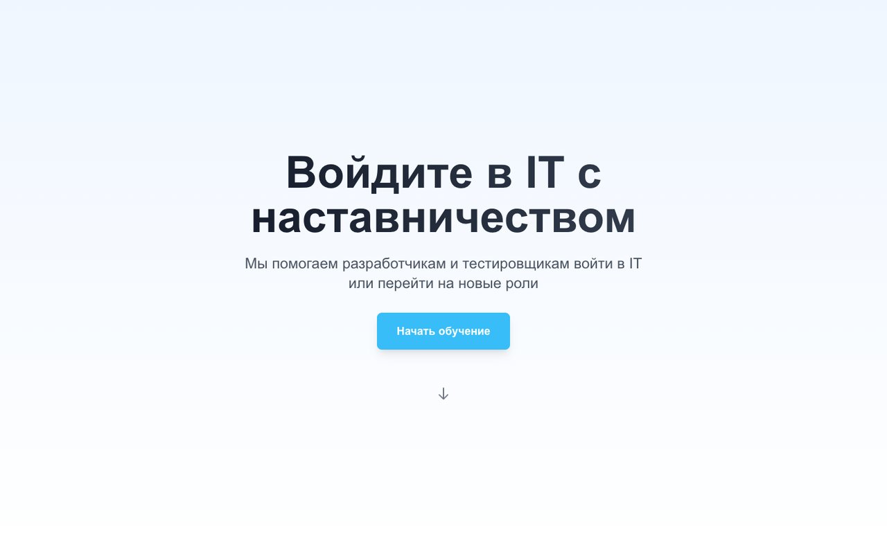
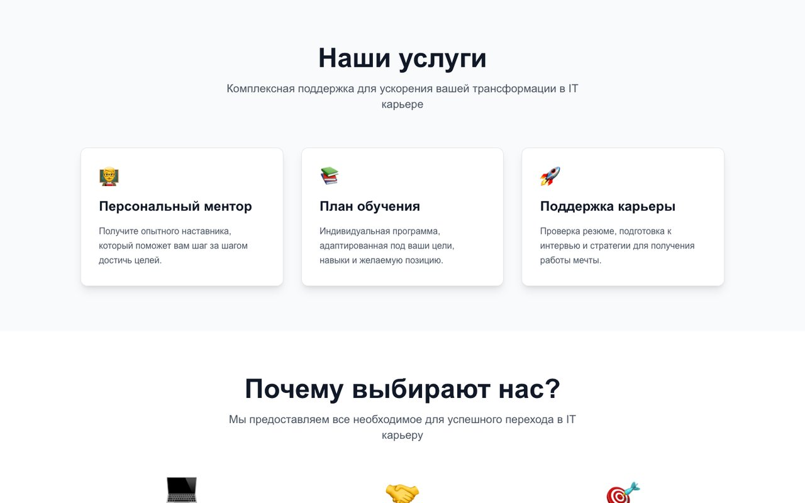
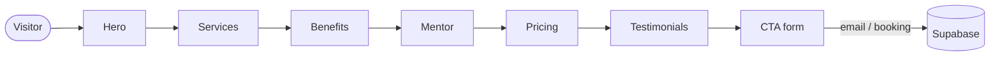

# MentorSite — IT career mentorship landing page

A modern, animated landing page for an IT mentorship service that helps developers and QA engineers break into IT or move to a new role. Built with Next.js, TypeScript, Tailwind CSS and Framer Motion.





## Sections

| Section | Content |
|---|---|
| **Hero** | Headline, value proposition and an animated call to action |
| **Services** | Personal mentor, learning plan, career support |
| **Benefits** | Why choose the service — with hover animations |
| **Mentor** | About the mentor |
| **Pricing** | Mentorship plans |
| **Testimonials** | Success stories |
| **CTA** | Email capture and consultation booking (Supabase) |



## Tech stack

Next.js 14 (App Router), React 18, TypeScript, Tailwind CSS, Framer Motion, Supabase.

## Getting started

```bash
npm install
# create .env.local with your Supabase URL and anon key
npm run dev        # http://localhost:3000
```

Production build:

```bash
npm run build
npm start
```
